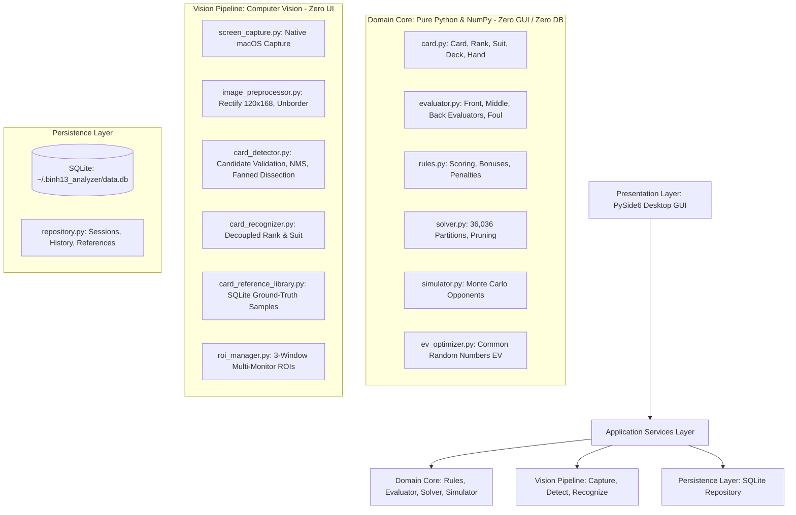
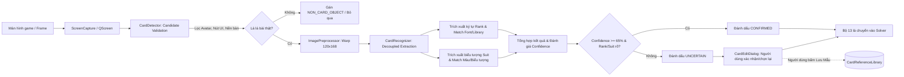

# SYSTEM ARCHITECTURE — BINH 13 ANALYZER (macOS)

---

## 1. SƠ ĐỒ KIẾN TRÚC TỔNG THỂ (CLEAN ARCHITECTURE)

Ứng dụng được thiết kế theo mô hình **Clean Architecture 5 tầng** với nguyên tắc phân tách độc lập và luồng phụ thuộc một chiều nghiêm ngặt:

---

## 2. NGUYÊN TẮC PHỤ THUỘC (DEPENDENCY INVARIANTS)

1. **Domain Core (`app/core/`) là hạt nhân độc lập tuyệt đối:**
   - **ZERO** dependencies đối với GUI (`PySide6`), thị giác máy tính (`cv2`), hoặc cơ sở dữ liệu (`sqlite3`).
   - Mọi thực thể chỉ dùng Python tiêu chuẩn và NumPy. Điều này đảm bảo tốc độ tối đa, không rò rỉ bộ nhớ và khả năng kiểm thử headless $100\%$.
2. **Vision Engine (`app/vision/`) độc lập với UI:**
   - Nhận đầu vào là mảng ảnh số (`np.ndarray`), xử lý và trả về các thực thể miền `Card` chuẩn.
   - Không chứa bất kỳ widget hay cửa sổ nào.
3. **Tầng Giao diện (`app/ui/`) không chứa logic nghiệp vụ nặng:**
   - Mọi tác vụ nặng (`Solver`, `EVOptimizer`, `VisionService`) bắt buộc chạy trên luồng phụ (`QThread`).
   - Giao tiếp giữa luồng nền và giao diện thực hiện duy nhất qua tín hiệu/khe cắm (`Signal`/`Slot`).
4. **Không tạo vòng lặp phụ thuộc (No Circular Dependencies):**
   - Tuyệt đối cấm import chéo giữa `app/ui/` và `app/core/` hoặc giữa `app/core/` và `app/vision/`.

---

## 3. KIẾN TRÚC PHÂN HỆ VISION THỰC TẾ

### Điểm đặc thù trong Vision Pipeline:
- **Tách bài xòe (Fanned card dissection):** Không dùng ô cố định; quét dải biên trên và dưới (16% margin strips) để tìm đỉnh gradient phân tách các lá bài bị chồng lấp.
- **Deduplication NMS:** Gộp các bounding box con bị bao bọc hoặc trùng lặp với IoU threshold 0.48.
- **Candidate Validation:** Kiểm tra độ tròn (avatar), độ bão hòa (nút UI), tỷ lệ giấy trắng và cấu trúc góc index để ngăn ngừa hoàn toàn hiện tượng nhận diện avatar thành quân bài.

---

## 4. KIẾN TRÚC MULTI-WINDOW (3 CỬA SỔ ĐỒNG THỜI)

1. **Chụp 1 Frame màn hình chung:** Thay vì chụp 3 lần gây giật lag, hệ thống chụp một khung hình desktop Retina duy nhất.
2. **Crop 3 ROI độc lập:** Dựa vào cấu hình trong `ROIManager`, trích xuất 3 khung hình tương ứng với 3 cửa sổ game (Table 1, Table 2, Table 3).
3. **Card Tracker bất biến vị trí (Position-Invariant State):**
   - Mỗi bàn duy trì mã băm `frozenset` của 13 lá bài (`position_invariant_hash`).
   - Khi bài chỉ di chuyển vị trí hoặc có animation xòe lại nhưng tập hợp 13 lá không đổi: **Hệ thống KHÔNG tính toán lại solver**, tiết kiệm $100\%$ CPU.
   - Khi có lá bài mới xuất hiện: Tự động kích hoạt solver và EV optimizer ở luồng nền.

---

## 5. KIẾN TRÚC LƯU TRỮ (DATABASE ARCHITECTURE)

- **Engine:** SQLite 3 cục bộ lưu tại đường dẫn cấu hình (mặc định trong bộ nhớ hoặc file database cục bộ).
- **Các bảng chính:**
  - `sessions`: Lưu thông tin ván chơi (thời gian, chế độ, nguồn ảnh).
  - `arrangements`: Lưu các thế bài 3 chi do solver tìm ra và người dùng lựa chọn.
  - `simulation_results`: Lưu kết quả EV, tỷ lệ thắng/hòa/thua của từng cách xếp.
  - `card_references`: Lưu trữ thư viện ảnh mẫu đã xác nhận (`card_code`, `rank`, `suit`, `image_path`, `confirmed`, `created_at`).
