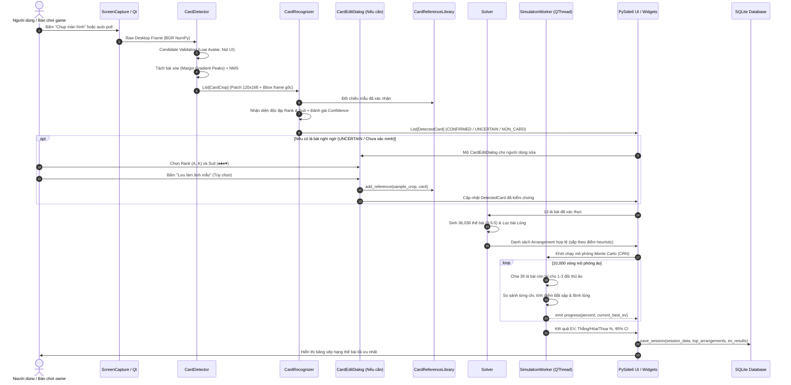

# DATA FLOW ARCHITECTURE — BINH 13 ANALYZER (macOS)

Tài liệu này mô tả chi tiết luồng dữ liệu đầu-cuối (End-to-End Data Flow) từ lúc chụp frame màn hình đến phân tích thế bài, mô phỏng Monte Carlo và lưu trữ lịch sử.

---

## 1. SƠ ĐỒ LUỒNG DỮ LIỆU ĐẦU-CUỐI

---

## 2. CHI TIẾT CÁC BƯỚC CHUYỂN HÓA DỮ LIỆU

### Bước 1: Tiếp Nhận & Tiền Xử Lý Hình Ảnh
- **Đầu vào:** Màn hình Retina macOS độ phân giải cao hoặc file ảnh nạp thủ công.
- **Biến đổi:**
  - Chuyển đổi Retina scale coordinates (1x sang 2x).
  - Loại bỏ viền xanh chọn bài trong game bằng bộ lọc không gian màu HSV:
    `H: 35-85, S > 50, V > 50` $\rightarrow$ gán lại thành nền trắng lá bài.
  - Perspective warp đưa về kích thước chuẩn $120 \times 168\text{ px}$.

### Bước 2: Phát Hiện Lá Bài & Lọc Rác (Detection)
- **Đầu vào:** BGR table image.
- **Quy tắc trích xuất:**
  - Phân tích biên gradient trên 2 dải biên an toàn (top 16% và bottom 16%) để không bị ảnh hưởng bởi hình vẽ tướng (J, Q, K).
  - Tìm các đỉnh phân cách giữa các lá bài xòe đè lên nhau.
  - Kiểm tra điều kiện hình học:
    - Loại bỏ nếu $0.82 \le w/h \le 1.28$ có độ trắng $< 50\%$ (avatar người chơi).
    - Loại bỏ nếu độ bão hòa màu $> 115$ (nút bấm UI).
- **Đầu ra:** Danh sách các đối tượng `CardCrop` kèm `bbox` gốc trên frame.

### Bước 3: Nhận Diện Độc Lập Rank & Suit (Recognition)
- **Đầu vào:** `CardCrop`.
- **Quy tắc nhận diện:**
  - Cắt vùng góc index `[0:105, 0:50]`, phân đoạn động thành `rank_crop` và `suit_crop` bằng Connected Components.
  - Phân loại màu: Đỏ (Hearts, Diamonds) vs Đen (Spades, Clubs).
  - Nhận diện Rank độc lập qua bộ font template matching đa tỷ lệ (24, 32, 40, 48).
  - Nhận diện Suit độc lập qua hình dạng biểu tượng.
  - Đối chiếu với `CardReferenceLibrary`: chỉ chấp nhận nếu Rank và Suit khớp độc lập với mẫu đã lưu.
- **Đầu ra:** Thực thể `DetectedCard` với trạng thái rõ ràng (`CONFIRMED`, `UNCERTAIN`, `NON_CARD_OBJECT`).

### Bước 4: Giải Bài Tổ Hợp (Combinatorial Solving)
- **Đầu vào:** Tập hợp đúng 13 lá bài duy nhất.
- **Giải thuật:**
  1. Chọn 3 lá cho Chi Đầu: $\binom{13}{3} = 286$ cách.
  2. Chọn 5 lá cho Chi Giữa từ 10 lá còn lại: $\binom{10}{5} = 252$ cách.
  3. 5 lá còn lại tự động là Chi Cuối.
  4. Triệt tiêu tính đối xứng giữa Chi Giữa và Chi Cuối: $\frac{286 \times 252}{2} = 36,036$ cách chia độc nhất.
  5. Áp dụng luật chống Binh Lủng: Loại bỏ ngay nếu $\text{Chi Cuối} < \text{Chi Giữa}$ hoặc $\text{Chi Giữa} < \text{Chi Đầu}$.
- **Đầu ra:** Danh sách các cách xếp bài hợp lệ (`Arrangement`).

### Bước 5: Mô Phỏng Monte Carlo & Tối Ưu EV (Simulation)
- **Đầu vào:** Top các thế bài hợp lệ, 39 lá bài chưa biết trong bộ bài 52 lá.
- **Kỹ thuật Common Random Numbers (CRN):**
  - Cố định seed ngẫu nhiên cho một lượt chạy để mọi thế bài ứng viên đều đối đầu với **cùng một chuỗi phân bài đối thủ ảo**.
  - Triệt tiêu phương sai ngẫu nhiên, giúp việc so sánh xếp hạng thế bài chuẩn xác gấp nhiều lần so với chia ngẫu nhiên độc lập.
- **Đầu ra:** Điểm EV kỳ vọng, tỷ lệ thắng từng chi, khoảng tin cậy 95%.
