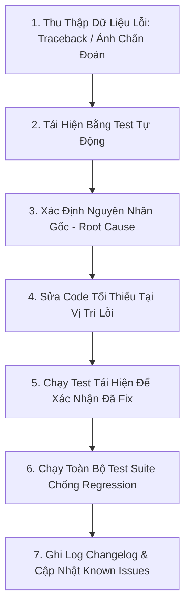

# WORKFLOW: ĐIỀU TRA & SỬA LỖI (DEBUG WORKFLOW)

Quy trình chuẩn hóa để tái hiện, cô lập và sửa triệt để các lỗi kỹ thuật trong Binh 13 Analyzer.

---

## 1. NGUYÊN TẮC CỐT LÕI KHI DEBUG
1. **Không đoán mò:** Mọi kết luận về nguyên nhân lỗi phải dựa trên log thực tế, traceback hoặc ảnh chụp chẩn đoán.
2. **Không sửa lan man (No Scope Creep):** Chỉ sửa đúng điểm lỗi gốc (Root Cause). Tuyệt đối không refactor các hàm/class không liên quan.
3. **Không sửa test để che giấu lỗi code:** Nếu test fail, phải sửa code cho đến khi pass đúng logic nghiệp vụ.

---

## 2. QUY TRÌNH 6 BƯỚC SỬA LỖI (STEP-BY-STEP)



### Bước 1: Tiếp Nhận & Thu Thập Bằng Chứng
- Xem xét kỹ hình ảnh thực tế, traceback hoặc output của lệnh chạy.
- Nếu lỗi thuộc phân hệ Vision:
  - Mở `VisionDebugDialog` để kiểm tra ảnh gốc, bounding box, Rank Crop, Suit Crop.
  - Kiểm tra xem đối tượng có phải avatar, nút UI hay nền bàn bị nhận diện nhầm không.
- Nếu lỗi thuộc phân hệ UI:
  - Kiểm tra stylesheet, padding, kích thước tối thiểu, signal/slot connection.

### Bước 2: Viết Test Tái Hiện (Reproduction Test)
- Thêm một test case trong file test tương ứng (ví dụ `tests/test_card_detection_and_reference.py` hoặc `tests/test_ui.py`) mô phỏng đúng dữ liệu đầu vào gây lỗi.
- Chạy test và chứng minh test FAILED trước khi sửa code.

### Bước 3: Xác Định Nguyên Nhân Gốc (Root Cause Analysis)
- Tìm hiểu tại sao mã nguồn lại hành xử như vậy:
  - Có phải do xung đột CSS padding toàn cục không?
  - Có phải do ngưỡng so khớp template matching quá lỏng không?
  - Có phải do tính toán tọa độ Retina bị lệch không?
  - Có phải do thiếu candidate validation trước khi nhận diện không?

### Bước 4: Sửa Code Cục Bộ
- Sửa đúng đoạn logic gây lỗi.
- Đảm bảo không làm thay đổi public interface nếu không cần thiết.

### Bước 5: Kiểm Chứng Lại (Verification)
- Chạy lại test tái hiện: Phải PASSED.
- Chạy toàn bộ test suite:
  ```bash
  .venv/bin/pytest tests/
  ```
  Phải đảm bảo 100% tests vượt qua, không có regression.

### Bước 6: Cập Nhật Hồ Sơ & Báo Cáo
- Cập nhật [.ai/state/KNOWN_ISSUES.md](file:///Users/levanquang/tool/.ai/state/KNOWN_ISSUES.md) (đánh dấu `RESOLVED` hoặc xóa nếu lỗi đã xử lý dứt điểm).
- Ghi nhật ký vào [.ai/logs/CHANGELOG.md](file:///Users/levanquang/tool/.ai/logs/CHANGELOG.md) mục `[Fixed]`.
- Báo cáo rõ: Nguyên nhân gốc, giải pháp đã áp dụng và kết quả test thực tế.
