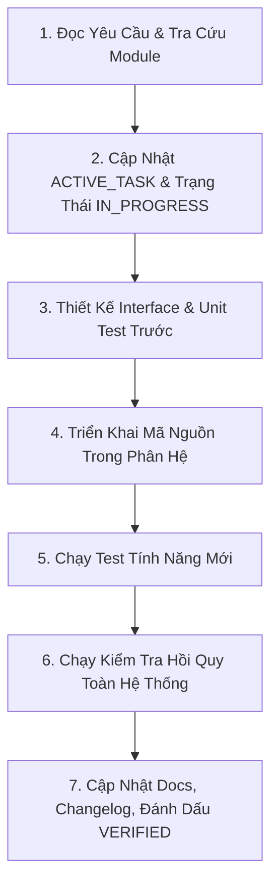

# WORKFLOW: TRIỂN KHAI TÍNH NĂNG MỚI (NEW FEATURE WORKFLOW)

Quy trình chuẩn hóa khi phát triển một tính năng mới trong Binh 13 Analyzer.

---

## 1. NGUYÊN TẮC BẮT BUỘC
1. Tính năng mới không được làm suy giảm hiệu năng hoặc phá vỡ 104 tests hiện có.
2. Tuân thủ triệt để Clean Architecture:
   - Logic miền thuần túy nằm trong `app/core/` (Zero GUI / Zero DB).
   - Thị giác máy tính nằm trong `app/vision/` (Zero GUI).
   - Tác vụ nặng chạy trên `QThread` trong `app/services/`.
   - Giao diện nằm trong `app/ui/`.
3. Mọi tính năng mới phải đi kèm ít nhất 1 bài unit test hoặc integration test trong `tests/`.

---

## 2. CÁC BƯỚC TRIỂN KHAI (STEP-BY-STEP)

### Bước 1: Khảo Sát & Xác Định Phạm Vi
- Đọc [PROJECT_VISION.md](file:///Users/levanquang/tool/.ai/PROJECT_VISION.md) và [ARCHITECTURE.md](file:///Users/levanquang/tool/.ai/ARCHITECTURE.md).
- Tra cứu [MODULE_MAP.md](file:///Users/levanquang/tool/.ai/MODULE_MAP.md) để xác định phân hệ chịu trách nhiệm.
- Kiểm tra [CHANGE_APPROVAL_POLICY.md](file:///Users/levanquang/tool/.ai/workflows/CHANGE_APPROVAL_POLICY.md): Nếu tính năng thay đổi public API hoặc schema DB, phải ghi nhận đề xuất trong [DECISIONS.md](file:///Users/levanquang/tool/.ai/DECISIONS.md) trước.

### Bước 2: Thiết Lập Trạng Thái
- Ghi nhận thông tin vào [ACTIVE_TASK.md](file:///Users/levanquang/tool/.ai/state/ACTIVE_TASK.md).
- Thiết lập trạng thái ban đầu là `IN_PROGRESS`.

### Bước 3: Viết Test Trước (Test-First Thinking)
- Tạo test case mới trong `tests/` mô tả hành vi kỳ vọng của tính năng.
- Chạy test để xác nhận test fail do chưa có code triển khai.

### Bước 4: Triển Khai Mã Nguồn
- Viết code tối thiểu để pass test.
- Đảm bảo đầy đủ type annotations (`from __future__ import annotations`, kiểu dữ liệu rõ ràng).
- Thêm docstring giải thích tham số và đầu ra.

### Bước 5: Kiểm Chứng & Đánh Giá
- Chạy test tính năng mới: `.venv/bin/pytest tests/test_<module>.py -v`.
- Chạy toàn bộ test suite để chống regression: `.venv/bin/pytest tests/`.
- Nếu có tác vụ tính toán, kiểm tra thời gian thực thi (không gây lag UI).

### Bước 6: Nghiệm Thu & Đồng Bộ
- Cập nhật tài liệu phân hệ tương ứng trong `.ai/modules/`.
- Cập nhật [.ai/state/CURRENT_STATE.md](file:///Users/levanquang/tool/.ai/state/CURRENT_STATE.md) chuyển trạng thái thành `VERIFIED`.
- Ghi nhật ký vào [.ai/logs/CHANGELOG.md](file:///Users/levanquang/tool/.ai/logs/CHANGELOG.md) mục `[Added]`.
- Đóng nhiệm vụ trong [.ai/state/ACTIVE_TASK.md](file:///Users/levanquang/tool/.ai/state/ACTIVE_TASK.md).
