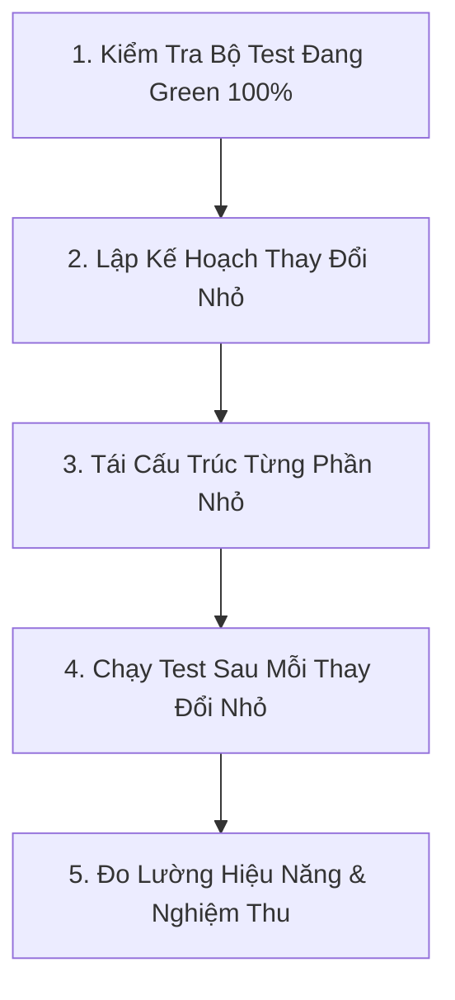

# WORKFLOW: TÁI CẤU TRÚC MÃ NGUỒN (REFACTOR WORKFLOW)

Quy trình chuẩn hóa khi tái cấu trúc code (cải thiện cấu trúc nội bộ, xóa nợ kỹ thuật mà không làm thay đổi hành vi bên ngoài).

---

## 1. NGUYÊN TẮC BẮT BUỘC KHI REFACTOR
1. **Phải có bài test bảo vệ trước khi bắt đầu:** Tuyệt đối không refactor mã nguồn nếu chưa có unit test phủ kín chức năng đó.
2. **Hành vi bên ngoài không được thay đổi (Behavior Invariance):** Mọi input và output của hệ thống phải giữ nguyên giá trị.
3. **Tuân thủ quy chế phê duyệt:** Nếu refactor ảnh hưởng đến public interface hoặc cấu trúc thư mục lớn, bắt buộc phải có sự phê duyệt theo [CHANGE_APPROVAL_POLICY.md](file:///Users/levanquang/tool/.ai/workflows/CHANGE_APPROVAL_POLICY.md).

---

## 2. QUY TRÌNH 5 BƯỚC REFACTOR



### Bước 1: Xác Nhận Trạng Thái Ban Đầu
- Chạy toàn bộ test suite:
  ```bash
  .venv/bin/pytest tests/
  ```
  Tất cả 104 test phải PASSED $100\%$ trước khi sửa bất kỳ dòng code nào.

### Bước 2: Phân Tách Thành Các Bước Nhỏ
- Không refactor 5 file cùng một lúc.
- Tách thành từng bước: Trích xuất hàm (Extract function), đổi tên biến nội bộ, loại bỏ mã trùng lặp (DRY), tối ưu mảng NumPy.

### Bước 3: Thực Hiện Từng Bước
- Sau mỗi bước nhỏ, chạy ngay test của file tương ứng để phát hiện sớm lỗi sai cú pháp hoặc kiểu dữ liệu.

### Bước 4: Kiểm Chứng Hồi Quy
- Chạy lại toàn bộ test suite `pytest tests/`.
- Nếu có tối ưu hiệu năng (như thuật toán Solver hoặc EV Optimizer), chạy script benchmark để so sánh thời gian trước và sau refactor.

### Bước 5: Cập Nhật Tài Liệu
- Cập nhật docstring và type hints.
- Cập nhật [.ai/logs/CHANGELOG.md](file:///Users/levanquang/tool/.ai/logs/CHANGELOG.md) mục `[Changed]`.
