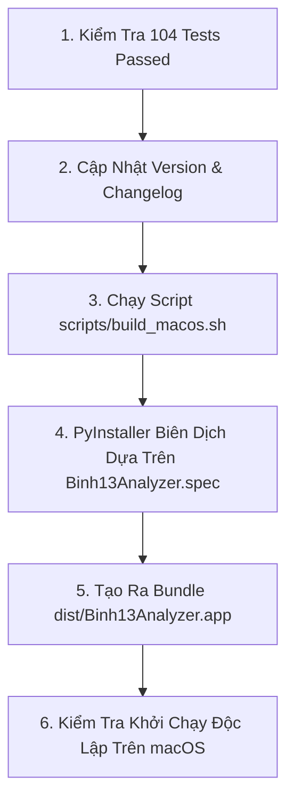

# WORKFLOW: ĐÓNG GÓI & PHÁT HÀNH (RELEASE WORKFLOW)

Quy trình chuẩn hóa khi đóng gói ứng dụng macOS native (`.app`) và phát hành phiên bản mới của Binh 13 Analyzer.

---

## 1. ĐIỀU KIỆN TIÊN QUYẾT TRƯỚC KHI ĐÓNG GÓI (GATEKEEPING)
1. Toàn bộ test suite phải PASSED 100%: `.venv/bin/pytest tests/`.
2. Git working tree phải sạch sẽ: `git status` báo `nothing to commit, working tree clean`.
3. Đã cập nhật số phiên bản trong `pyproject.toml` và [.ai/logs/CHANGELOG.md](file:///Users/levanquang/tool/.ai/logs/CHANGELOG.md).

---

## 2. QUY TRÌNH ĐÓNG GÓI BUNDLE MACOS (`.APP`)



### Bước 1: Kiểm Tra Toàn Diện
```bash
.venv/bin/pytest tests/
```
Nếu có bất kỳ test nào fail, dừng ngay quy trình đóng gói.

### Bước 2: Chạy Lệnh Build
```bash
./scripts/build_macos.sh
```
Script này sử dụng PyInstaller với cấu hình trong `Binh13Analyzer.spec`:
- Đóng gói PySide6, OpenCV, NumPy và các file assets font bitmap.
- Thiết lập `CFBundleIdentifier`, `CFBundleName`, và quyền truy cập macOS HighDPI.
- Tạo thư mục `dist/Binh13Analyzer.app`.

### Bước 3: Kiểm Tra Gói Ứng Dụng Sau Khi Build
- Chạy thử ứng dụng từ thư mục `dist/`:
  ```bash
  open dist/Binh13Analyzer.app
  ```
- Kiểm tra ứng dụng mở lên không bị crash thiếu thư viện động (`.dylib`).
- Kiểm tra tính năng nhận diện ảnh và solver hoạt động bình thường.

### Bước 4: Gắn Tag Phiên Bản (Git Tag)
```bash
git tag -a v1.2.0 -m "Release v1.2.0: AI Master Engineer System & Vision Stability"
git push origin --tags
```
