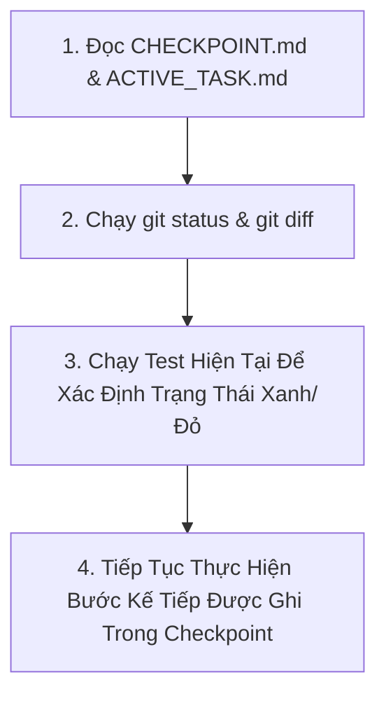

# WORKFLOW: TIẾP TỤC NHIỆM VỤ BỊ GIÁN ĐOẠN (RESUME TASK WORKFLOW)

Quy trình chuẩn hóa giúp AI Agent ở phiên mới tiếp tục chính xác một nhiệm vụ chưa hoàn thành mà không phải làm lại từ đầu.

---

## 1. NGUYÊN TẮC TIẾP TỤC
1. **Đọc Checkpoint trước tiên:** Mọi thông tin về tiến độ dở dang, file đang sửa và bước tiếp theo nằm trong [.ai/state/CHECKPOINT.md](file:///Users/levanquang/tool/.ai/state/CHECKPOINT.md) và [.ai/state/ACTIVE_TASK.md](file:///Users/levanquang/tool/.ai/state/ACTIVE_TASK.md).
2. **Không xóa bỏ phần đã làm:** Kiểm tra `git status` và git diff để hiểu những thay đổi mà phiên trước đã thực hiện.
3. **Tiếp nối trực tiếp:** Bắt đầu ngay từ bước được chỉ định trong mục `Điểm Tiếp Tục (Resumption Point)`.

---

## 2. QUY TRÌNH 4 BƯỚC TIẾP TỤC (RESUMPTION STEPS)



### Bước 1: Đọc Thông Tin Checkpoint
- Đọc [.ai/state/CHECKPOINT.md](file:///Users/levanquang/tool/.ai/state/CHECKPOINT.md).
- Xác định:
  - Tên nhiệm vụ.
  - Những file đã sửa xong.
  - File đang sửa dở dang.
  - Bước kế tiếp cần làm ngay.

### Bước 2: Kiểm Tra Trạng Thái Git
```bash
git status
git diff --stat
```
- Xác nhận các file đang sửa dở dang vẫn còn nguyên vẹn trên working tree.

### Bước 3: Kiểm Tra Hiện Trạng Test
- Chạy test của module đang sửa:
  ```bash
  .venv/bin/pytest tests/test_<module>.py
  ```
- Xem xét bài test đang pass hay fail để xác định điểm xuất phát kỹ thuật.

### Bước 4: Triển Khai Tiếp & Cập Nhật Checkpoint
- Viết tiếp code theo đúng hướng dẫn trong `Resumption Point`.
- Khi hoàn thành từng mốc, cập nhật lại `CHECKPOINT.md`.
- Khi nhiệm vụ hoàn tất $100\%$ và đã pass test: Đóng task và chuyển trạng thái thành `VERIFIED`.
