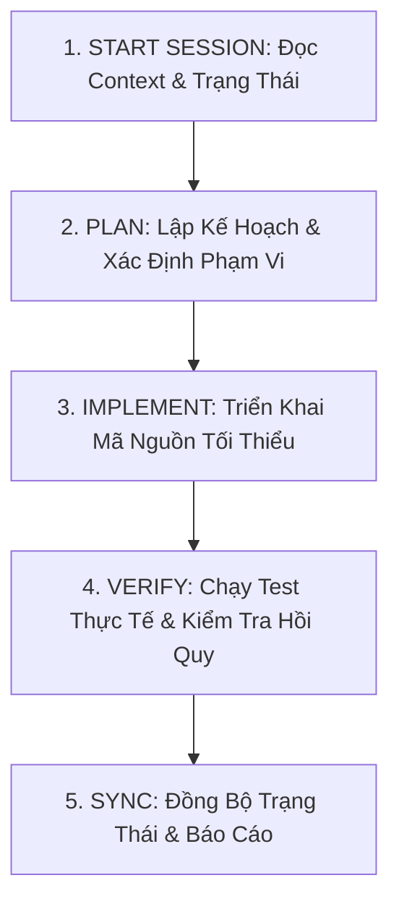

# AI AGENT SESSION WORKFLOW — BINH 13 ANALYZER

Tài liệu này quy định quy trình 5 bước **bắt buộc** áp dụng cho mọi AI Agent khi nhận một nhiệm vụ mới trên repository này.

---

---

## BƯỚC 1: START SESSION (KHỞI ĐỘNG PHIÊN)

Mỗi phiên làm việc, AI **bắt buộc** thực hiện theo thứ tự:
1. Đọc file chỉ dẫn gốc [MASTER_CONTEXT.md](file:///Users/levanquang/tool/MASTER_CONTEXT.md).
2. Đọc trạng thái hiện tại [.ai/state/CURRENT_STATE.md](file:///Users/levanquang/tool/.ai/state/CURRENT_STATE.md) và [.ai/state/ACTIVE_TASK.md](file:///Users/levanquang/tool/.ai/state/ACTIVE_TASK.md).
3. Tra cứu [.ai/MODULE_MAP.md](file:///Users/levanquang/tool/.ai/MODULE_MAP.md) để xác định các file source code và test liên quan đến nhiệm vụ.
4. Kiểm tra Git: Chạy `git status` để đảm bảo working tree sạch sẽ, **không ghi đè những thay đổi chưa commit của người dùng**.
5. **Chỉ đọc các file cần thiết:** Tuyệt đối không đọc toàn bộ 30+ file trong repository nếu chỉ sửa một hàm hoặc một dialog.

---

## BƯỚC 2: PLAN (LẬP KẾ HOẠCH & XÁC ĐỊNH PHẠM VI)

Trước khi viết bất kỳ dòng code nào, AI phải xác định rõ:
1. **Mục tiêu cụ thể:** Nhiệm vụ này giải quyết lỗi gì hoặc thêm tính năng gì?
2. **Phạm vi tác động (Scope):** Chỉ rõ các file sẽ sửa và các file **tuyệt đối không được đụng vào**.
3. **Dependencies:** Thay đổi này có ảnh hưởng đến các module khác hay không?
4. **Rủi ro kỹ thuật:** Có nguy cơ phá vỡ public interface hay gây regression không?
5. **Tiêu chí nghiệm thu (Acceptance Criteria):** Điều kiện nào chứng minh nhiệm vụ hoàn thành?

---

## BƯỚC 3: IMPLEMENT (TRIỂN KHAI CODE)

1. Triển khai theo từng bước nhỏ (Incremental changes).
2. Tuân thủ nghiêm ngặt kiến trúc Clean Architecture:
   - Không đưa GUI vào `app/core/`.
   - Không đưa Raw SQL vào `app/ui/`.
3. Giữ nguyên toàn bộ comment, docstrings và cấu trúc hiện có không liên quan.
4. Không xóa code cũ chỉ vì chưa hiểu lý do nó tồn tại.
5. Không tạo thêm các abstraction phức tạp (design pattern dư thừa) khi giải pháp đơn giản trực tiếp là đủ.

---

## BƯỚC 4: VERIFY (KIỂM CHỨNG BẮT BUỘC)

1. **Chạy test module liên quan trực tiếp:**
   Ví dụ khi sửa Vision: `.venv/bin/pytest tests/test_card_detection_and_reference.py -v`.
2. **Chạy kiểm tra hồi quy toàn diện (Regression Check):**
   Chạy `.venv/bin/pytest tests/` để đảm bảo không làm gãy bất kỳ test nào trong số 104 test hiện có.
3. **Quy tắc trung thực kiểm thử:**
   - Tuyệt đối không tuyên bố test pass nếu chưa chạy lệnh.
   - Nếu test fail, phải sửa code cho đến khi pass thật, không được sửa test để che giấu lỗi code.

---

## BƯỚC 5: SYNC (ĐỒNG BỘ TRI THỨC & BÁO CÁO)

Sau khi kiểm chứng thành công:
1. Cập nhật [.ai/state/CURRENT_STATE.md](file:///Users/levanquang/tool/.ai/state/CURRENT_STATE.md).
2. Cập nhật [.ai/state/ACTIVE_TASK.md](file:///Users/levanquang/tool/.ai/state/ACTIVE_TASK.md) (đóng task hoặc lưu điểm tiếp tục nếu task dài).
3. Ghi nhật ký vào [.ai/logs/CHANGELOG.md](file:///Users/levanquang/tool/.ai/logs/CHANGELOG.md).
4. Cập nhật [.ai/state/TEST_STATUS.md](file:///Users/levanquang/tool/.ai/state/TEST_STATUS.md) nếu số lượng test thay đổi.
5. Báo cáo ngắn gọn cho người dùng: Các file đã sửa, nguyên nhân, giải pháp, kết quả test thực tế.
