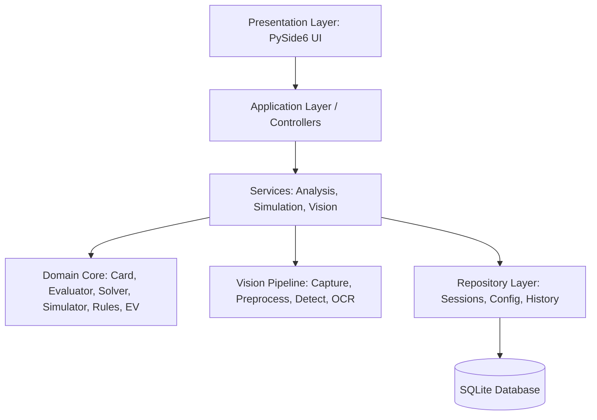

# ARCHITECTURE DESIGN — BINH 13 ANALYZER (macOS)

## 1. Architectural Philosophy & Layered Separation
The application follows Clean Architecture principles with strict unidirectional dependencies:

### Dependency Rules:
1. **Domain Core (`app/core/`)** has **ZERO** dependencies on GUI (`PySide6`), vision, or database. It consists purely of Python and NumPy. This ensures lightning-fast execution, zero memory leaks, and 100% testability.
2. **Vision Engine (`app/vision/`)** is independent of the UI layer. It processes NumPy image arrays and returns standardized `Card` domain entities.
3. **Repository Layer (`app/database/`)** handles SQLite persistence. Domain core and UI never execute raw SQL.
4. **Presentation Layer (`app/ui/`)** communicates solely through Qt Signals/Slots and worker threads (`QThread`), guaranteeing the UI never freezes during heavy solver or Monte Carlo simulations.

---

## 2. Component Breakdown

### 2.1. Domain Core (`app/core/`)
- `card.py`:
  - `Rank` (Enum: TWO=2 ... ACE=14)
  - `Suit` (Enum: SPADES=1, CLUBS=2, DIAMONDS=3, HEARTS=4)
  - `Card`: Value object with integer encoding $0..51$ for bitwise & lookup operations, unicode display (`A♠`), parser from `As`, `10h`, etc.
  - `Deck`: 52-card standard deck, seeded shuffle, dealing.
  - `Hand`: Container of cards with uniqueness validation.
- `evaluator.py`:
  - `HandCategory` (HighCard=1, Pair=2, TwoPair=3, Trips=4, Straight=5, Flush=6, FullHouse=7, Quads=8, StraightFlush=9).
  - `HandEvaluation`: Score tuple with category and lexicographically comparable tie-break vector.
  - Evaluators for 3-card front hand and 5-card middle/back hand.
  - Straight handling: Supports configurable wheel A-2-3-4-5 (evaluated either as lowest straight 5-high or second highest under specific house rules).
- `solver.py`:
  - Combinatorial engine partitioning 13 cards into $\binom{13}{3} \times \binom{10}{5} / 2 = 36,036$ candidate 3-5-5 splits.
  - Foul rule enforcement: $\text{Back Hand} \ge \text{Middle Hand} \ge \text{Front Hand}$.
  - Pruning & heuristic scoring for initial rapid sorting.
- `rules.py`:
  - Game rule configurations: Player count (2-4), point values, sweep multipliers, penalty for foul hands, special instant-win hands (Dragon, 3 flushes, etc.).
- `simulator.py`:
  - Monte Carlo simulation engine: Deals remaining 39 unseen cards to opponents.
  - Opponent strategies: Random Legal, Heuristic Front/Back, Greedy.
  - Head-to-head comparison per hand against each opponent.
- `ev_optimizer.py`:
  - Common Random Numbers (CRN) runner for fair comparison across all candidate arrangements.
  - Statistical accumulator: Mean EV, standard deviation, standard error, 95% confidence intervals.

### 2.2. Vision Pipeline (`app/vision/`)
- `screen_capture.py`: Native macOS screen capture utility using `screencapture` or Qt native grabber with retina display coordinate handling.
- `image_preprocessor.py`: Grayscale conversion, Otsu thresholding, contour detection, perspective transform to extract card rectangles.
- `card_detector.py`: Segments individual card bounding boxes from table region.
- `card_recognizer.py`: Pluggable recognition module supporting:
  - Phase 1: Robust normalized template matching for corner index (rank & suit).
  - Phase 2: Interface for ONNX neural network classification (`.onnx`).
- `recognition_validator.py`: Asserts exactly 13 distinct cards are identified; highlights ambiguous or duplicate cards for human-in-the-loop validation.

### 2.3. Presentation Layer (`app/ui/`)
- Native macOS aesthetics with dark and light theme support.
- Worker threads (`QThread`) with progress bar, ETA, and cancellation support.
- Interactive card selection dialog and drag/drop reordering.

---

## 3. Data Flow
1. **Input Phase:** User selects 13 cards manually OR captures a screenshot region $\rightarrow$ Vision pipeline detects cards $\rightarrow$ User confirms/edits 13 cards.
2. **Solving Phase:** `Solver` partitions 13 cards into valid non-foul $(3, 5, 5)$ arrangements $\rightarrow$ Initial heuristic ranks top candidates.
3. **Simulation Phase:** `EVOptimizer` runs Monte Carlo on top candidates against simulated opponents using CRN $\rightarrow$ Emits progress signals $\rightarrow$ Computes EV and win/tie/loss probabilities.
4. **Presentation & Persistence:** Results displayed in ranked table with interactive hand breakdown $\rightarrow$ Saved to SQLite database.
